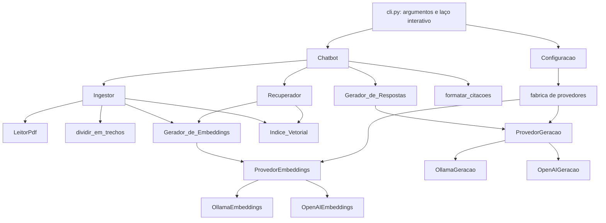
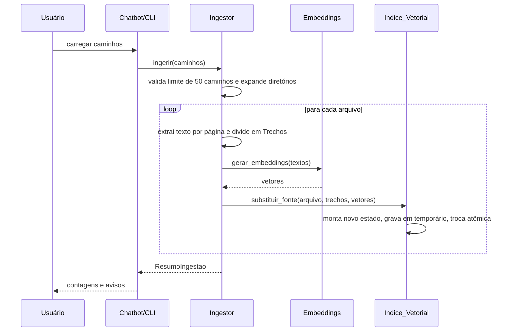
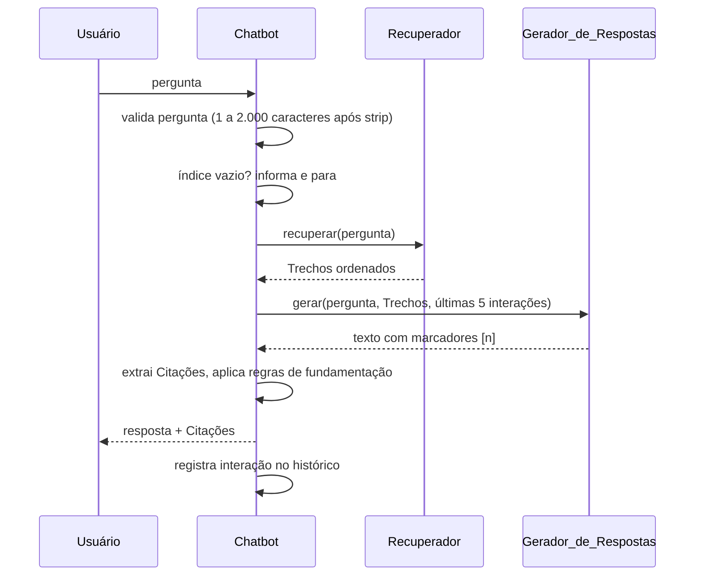

# Design Document: PDF RAG Chatbot

## Overview

O PDF RAG Chatbot é uma aplicação de linha de comando (CLI) interativa em Python que responde perguntas com base em PDFs fornecidos pelo usuário, usando RAG (Retrieval-Augmented Generation). O fluxo tem duas fases:

1. **Indexação**: o `Ingestor` extrai o texto de cada página, divide em Trechos, o `Gerador_de_Embeddings` converte cada Trecho em vetor e o `Indice_Vetorial` guarda tudo em disco.
2. **Consulta**: o `Recuperador` busca os Trechos mais similares à pergunta, o `Gerador_de_Respostas` redige a resposta em português com base neles e o `Chatbot` exibe a resposta com as Citações (arquivo e página).

### Decisões de stack

| Decisão | Escolha | Justificativa |
|---|---|---|
| Linguagem | Python 3.11+ | Ecossistema de PDF e IA, simples de executar e de demonstrar no portfólio. |
| Interface | CLI interativa (`python -m pdf_rag_chatbot`) | Atende o Requisito 4 sem custo de UI; fácil de capturar em prints (Requisito 8.4). |
| Extração de PDF | `pypdf` | Python puro, sem dependência de binários do sistema, extrai texto por página. |
| Provedor local | Ollama (`nomic-embed-text` para embeddings, `llama3.2` para geração) | Gratuito, roda na máquina do usuário, API HTTP simples. Modelos configuráveis por variável de ambiente. |
| Provedor externo | OpenAI (`text-embedding-3-small`, `gpt-4o-mini`) | API REST estável e amplamente conhecida. Modelos configuráveis. |
| Cliente HTTP | `httpx` | Suporta timeout por requisição e `MockTransport`, o que permite testar sem rede. |
| Índice vetorial | Implementação própria com `numpy` (similaridade por cosseno), persistida em `vectors.npy` + `chunks.json` + `meta.json` | Ver "Decisão: índice próprio" abaixo. |
| Configuração | `python-dotenv` + variáveis de ambiente | Variável de ambiente prevalece sobre o `.env` (Requisito 5.4). |
| Testes | `pytest` + `hypothesis` | Hypothesis é a biblioteca de property-based testing para Python; não será implementada PBT do zero. |

### Decisão: índice próprio em numpy em vez de ChromaDB ou FAISS

| Critério | numpy + JSON | ChromaDB | FAISS |
|---|---|---|---|
| Dependências | Só `numpy` | Muitas, com binários | Binário nativo, instalação variável no Windows |
| Escala necessária (até 10.000 Trechos, Req. 2.5) | Busca exata por produto matricial em milissegundos | Excessivo | Excessivo |
| Atomicidade da substituição por arquivo (Req. 1.9, 1.10) | Controle total: monta o novo estado e troca de uma vez | Depende da API | Exige lógica extra |
| Testabilidade das propriedades (ida e volta, ordenação) | Determinística e inspecionável | Menos transparente | Menos transparente |
| Valor didático para o portfólio | Alto: mostra como a busca vetorial funciona | Menor | Menor |

O índice cabe em memória para o volume do projeto. A abstração `Indice_Vetorial` expõe uma interface pequena, então trocar por ChromaDB ou FAISS no futuro não afeta os demais componentes (listado como evolução no Readme).

### Pesquisa e referências

- API do Ollama: `POST /api/embed` (campo `input` aceita lista de textos e devolve `embeddings`), `POST /api/chat` (com `stream: false`) e `GET /api/tags` (lista modelos instalados, usado na verificação de inicialização). Documentação: https://github.com/ollama/ollama/blob/main/docs/api.md
- API da OpenAI: `POST /v1/embeddings` e `POST /v1/chat/completions`. Documentação: https://platform.openai.com/docs/api-reference
- `pypdf`: `PdfReader(path).pages[i].extract_text()` devolve texto por página (pode devolver vazio em PDFs escaneados). Documentação: https://pypdf.readthedocs.io
- Hypothesis: https://hypothesis.readthedocs.io

Conclusões que afetam o design: (a) PDFs escaneados retornam texto vazio, o que motiva o Requisito 1.8; (b) as duas APIs aceitam embeddings em lote, então o `Gerador_de_Embeddings` trabalha em lote; (c) o Ollama não tem chave de API, então o provedor local só precisa de verificação de disponibilidade e de modelo instalado.

## Architecture

Clean Architecture simplificada: o núcleo (modelos e lógica pura) não depende de rede nem de disco, e os adaptadores de provedores ficam atrás de interfaces (`Protocol`). Isso permite trocar provedores por configuração e testar tudo com dublês.



### Fluxo de indexação



### Fluxo de consulta



### Decisões de projeto

- **Citações por marcadores `[n]`**: cada Trecho recuperado entra no prompt numerado (`[1]`, `[2]`, ...). O modelo é instruído a marcar as afirmações com esses números. O `Chatbot` converte os marcadores em Citações, descarta números que não existem e remove repetições. Assim, a lista de Citações contém apenas Trechos efetivamente usados (Requisito 3.3) e nunca arquivos inventados pelo modelo.
- **Resposta sem informação**: o prompt instrui o modelo a responder exatamente com o sentinela `SEM_RESPOSTA` quando os Trechos não bastam. O `Chatbot` troca o sentinela pela mensagem "não encontrada nos documentos carregados" e não exibe Citações (Requisito 3.4).
- **Chunking por página**: o texto é dividido página a página, então nenhum Trecho cruza páginas e a página de origem é exata (Requisito 1.4). A divisão usa janelas fixas de caracteres, o que torna o tamanho e a sobreposição verificáveis por propriedade.
- **Substituição atômica por arquivo**: `substituir_fonte` calcula o novo estado completo, grava em arquivos temporários e só então troca os arquivos finais (`os.replace`) e o estado em memória. Se qualquer passo falha, o estado anterior permanece (Requisitos 1.9 e 1.10). Os embeddings são gerados antes de tocar no índice.
- **Compatibilidade do modelo de embedding**: `meta.json` guarda o nome do modelo e a dimensão. Se a configuração atual usa outro modelo, o índice recusa consultas e novas inserções com erro orientando a reindexar. Isso garante que Trechos e perguntas usem o mesmo modelo (Requisitos 2.1 e 2.4).
- **Sem fallback entre provedores**: se o provedor local falha, a inicialização termina. O sistema nunca troca para o externo sozinho (Requisito 5.7).
- **Estado de falha sem retenção**: o `Chatbot` mantém Trechos e Citações apenas em variáveis locais da chamada de `responder`. Em falha, a exceção descarta tudo e uma nova tentativa refaz a recuperação (Requisitos 3.8 e 3.9).

### Estrutura do repositório

```
.
├── src/pdf_rag_chatbot/
│   ├── __main__.py            # python -m pdf_rag_chatbot
│   ├── cli.py                 # argumentos, laço interativo, comandos
│   ├── chatbot.py             # Chatbot (orquestra consulta e histórico)
│   ├── config.py              # Configuracao, validação, carga de .env
│   ├── erros.py               # hierarquia de exceções
│   ├── modelos.py             # Trecho, Citacao, ResultadoBusca, ResumoIngestao
│   ├── chunking.py            # dividir_em_trechos (função pura)
│   ├── ingestor.py            # Ingestor, LeitorPdf
│   ├── citacoes.py            # extrair_citacoes, formatar_citacao
│   ├── indice_vetorial.py     # Indice_Vetorial (numpy + disco)
│   ├── recuperador.py         # Recuperador
│   ├── embeddings/            # base.py, ollama.py, openai.py
│   ├── geracao/               # base.py, ollama.py, openai.py, prompt.py
│   ├── fabrica.py             # cria provedores a partir da Configuracao
│   └── log_seguro.py          # filtro que oculta chaves de API
├── tests/
├── inputs/                    # Documento_de_Sentencas e PDFs de exemplo
├── docs/img/                  # prints de tela para o Readme
├── .env.example  .gitignore  LICENSE  README.md
└── requirements.txt  requirements-dev.txt
```

`requirements.txt` declara `pypdf>=4.0`, `numpy>=1.26`, `httpx>=0.27` e `python-dotenv>=1.0`. `requirements-dev.txt` inclui `-r requirements.txt`, `pytest>=8.0` e `hypothesis>=6.100` (Requisito 9.2). A licença é MIT, com ano e titular (Requisito 9.3).

## Components and Interfaces

Todas as mensagens ao usuário ficam em português, centralizadas em `mensagens.py` para facilitar testes por conteúdo.

### Configuracao (`config.py`)

```python
@dataclass(frozen=True)
class Configuracao:
    provedor_embeddings: Literal["local", "externo"]
    provedor_geracao: Literal["local", "externo"]
    tamanho_trecho: int = 1000          # 100..10000
    sobreposicao: int = 200             # 0..50% do tamanho_trecho
    top_k: int = 4                      # 1..20
    diretorio_indice: Path = Path("data/index")
    ollama_host: str = "http://localhost:11434"
    modelo_embeddings_local: str = "nomic-embed-text"
    modelo_geracao_local: str = "llama3.2"
    modelo_embeddings_externo: str = "text-embedding-3-small"
    modelo_geracao_externo: str = "gpt-4o-mini"
    chave_api: str | None = None        # nunca é impressa nem logada
    timeout_geracao_s: float = 60.0
    timeout_conexao_local_s: float = 10.0

def carregar_configuracao(env: Mapping[str, str] | None = None,
                          arquivo_env: Path | None = Path(".env")) -> Configuracao: ...
def validar_parametros_chunking(tamanho: int, sobreposicao: int) -> None: ...
def validar_top_k(valor: object) -> int: ...
```

Variáveis de ambiente: `PROVEDOR_EMBEDDINGS`, `PROVEDOR_GERACAO` (valores `local` ou `externo`), `OPENAI_API_KEY`, `OLLAMA_HOST`, `MODELO_EMBEDDINGS_LOCAL`, `MODELO_GERACAO_LOCAL`, `MODELO_EMBEDDINGS_EXTERNO`, `MODELO_GERACAO_EXTERNO`, `TAMANHO_TRECHO`, `SOBREPOSICAO`, `TOP_K`, `DIRETORIO_INDICE`.

Regras:
- `carregar_configuracao` usa `dotenv_values` para ler o `.env` e mescla com `os.environ`, com o ambiente vencendo em caso de conflito (Requisito 5.4).
- `PROVEDOR_EMBEDDINGS` ou `PROVEDOR_GERACAO` ausente ou fora de `{local, externo}` lança `ErroConfiguracao` com o nome da variável e os valores aceitos (Requisito 5.1, 5.2).
- Se qualquer um dos dois provedores é `externo` e `OPENAI_API_KEY` está ausente, vazia ou só com espaços, lança `ErroChaveApi` com o nome da variável (Requisito 5.5).
- `validar_parametros_chunking` e `validar_top_k` lançam `ErroConfiguracao` citando o parâmetro e a faixa aceita (Requisitos 1.3, 2.7).

### Modelos de dados (`modelos.py`)

```python
@dataclass(frozen=True)
class Trecho:
    texto: str
    fonte: str        # nome do arquivo (ex.: "artigo.pdf")
    pagina: int       # >= 1; para o Documento_de_Sentencas, número da linha
    tipo: Literal["pdf", "texto"] = "pdf"

@dataclass(frozen=True)
class Citacao:
    fonte: str
    pagina: int
    tipo: Literal["pdf", "texto"]

@dataclass(frozen=True)
class ResultadoBusca:
    trecho: Trecho
    similaridade: float
```

### Chunking (`chunking.py`)

```python
def dividir_em_trechos(texto: str, tamanho: int, sobreposicao: int) -> list[str]: ...
```

Função pura. Após `texto.strip()`, se o texto é vazio devolve `[]`. Caso contrário usa passo `p = tamanho - sobreposicao` e janelas `texto[i*p : i*p + tamanho]`, parando quando uma janela alcança o fim do texto. Como a sobreposição é no máximo 50% do tamanho, `p >= tamanho/2 > 0` e o laço sempre termina. Resultado: cada Trecho tem entre 1 e `tamanho` caracteres, dois Trechos consecutivos compartilham exatamente `sobreposicao` caracteres, e `trechos[0] + "".join(t[sobreposicao:] for t in trechos[1:])` reconstrói o texto.

### Ingestor (`ingestor.py`)

```python
class LeitorPdf(Protocol):
    def ler_paginas(self, caminho: Path) -> list[str]: ...   # texto por página, em ordem

class Ingestor:
    LIMITE_CAMINHOS = 50
    def __init__(self, leitor: LeitorPdf, embeddings: GeradorDeEmbeddings,
                 indice: IndiceVetorial, tamanho: int, sobreposicao: int): ...
    def ingerir(self, caminhos: Sequence[Path]) -> ResumoIngestao: ...
```

Comportamento de `ingerir`:
1. Valida `tamanho` e `sobreposicao` (já validados na construção; se inválidos, `ErroConfiguracao` e nenhum arquivo é processado).
2. Se `len(caminhos) > 50`, lança `ErroLimiteCaminhos(recebidos, limite=50)` antes de abrir qualquer arquivo; o índice não muda (Requisitos 1.12 a 1.14).
3. Expande cada diretório para os arquivos diretos cuja extensão, em minúsculas, é `.pdf`, sem recursão. Diretório sem PDFs gera aviso "nenhum PDF encontrado" (Requisito 1.6).
4. Para cada arquivo, isolado em `try/except`: 
   - `.pdf`: lê as páginas, descarta páginas vazias após `strip`, divide cada página com `dividir_em_trechos` e cria `Trecho(texto, fonte=nome, pagina=n)` com `n` iniciando em 1. Se nenhuma página tem texto, registra aviso "sem texto extraível" e ignora o arquivo (Requisito 1.8).
   - `.txt` (Documento_de_Sentencas): decodifica como UTF-8; cada linha não vazia vira um `Trecho(tipo="texto", pagina=<número da linha>)`. Se a decodificação falha ou não há linha não vazia, registra falha com o nome do arquivo e o motivo, sem indexar nada (Requisitos 7.4, 7.5).
   - Gera os embeddings do lote e chama `indice.substituir_fonte(nome, trechos, vetores)`.
   - Qualquer exceção vira `FalhaArquivo(nome, motivo)`; o índice mantém o estado anterior do arquivo e o processamento segue para o próximo (Requisitos 1.7, 1.10).
5. Devolve `ResumoIngestao(sucessos, falhas_ou_ignorados, total_trechos, mensagens)`. A CLI imprime as três contagens (Requisito 1.11).

O `LeitorPdfPypdf` implementa `LeitorPdf` com `pypdf.PdfReader`. Dividir `LeitorPdf` como interface permite testar o `Ingestor` sem PDFs reais.

### Gerador_de_Embeddings (`embeddings/`)

```python
class ProvedorEmbeddings(Protocol):
    nome_modelo: str
    def embutir(self, textos: Sequence[str]) -> list[list[float]]: ...

class GeradorDeEmbeddings:
    def __init__(self, provedor: ProvedorEmbeddings, tamanho_lote: int = 64): ...
    @property
    def nome_modelo(self) -> str: ...
    def gerar(self, textos: Sequence[str]) -> np.ndarray: ...   # shape (n, d), float32
```

`GeradorDeEmbeddings.gerar` divide em lotes, concatena e valida que o resultado tem exatamente `len(textos)` vetores com a mesma dimensão; caso contrário lança `ErroEmbeddings`. Implementações:
- `OllamaEmbeddings`: `POST {host}/api/embed` com `{model, input: [...]}`.
- `OpenAIEmbeddings`: `POST https://api.openai.com/v1/embeddings` com `Authorization: Bearer <chave>`.

Ambas recebem um `httpx.Client` por injeção, usado nos testes com `httpx.MockTransport`.

### Indice_Vetorial (`indice_vetorial.py`)

```python
class IndiceVetorial:
    def __init__(self, diretorio: Path, nome_modelo: str): ...
    def carregar(self) -> None: ...
    def substituir_fonte(self, fonte: str, trechos: Sequence[Trecho], vetores: np.ndarray) -> None: ...
    def buscar(self, vetor: np.ndarray, k: int, fontes: Collection[str] | None = None) -> list[ResultadoBusca]: ...
    def listar_fontes(self) -> list[str]: ...        # ordem alfabética, sem repetição
    def esta_vazio(self) -> bool: ...
    def __len__(self) -> int: ...
```

Armazenamento em `diretorio_indice`:
- `vectors.npy`: matriz `float32` `(n, d)` com vetores já normalizados (norma 1), de modo que o produto escalar é a similaridade por cosseno.
- `chunks.json`: lista de `{texto, fonte, pagina, tipo}` na mesma ordem das linhas da matriz.
- `meta.json`: `{modelo_embeddings, dimensao, versao_formato}`.

Operações:
- `substituir_fonte`: remove as linhas de `fonte`, acrescenta as novas, normaliza, grava os três arquivos em temporários no mesmo diretório e troca com `os.replace`. Só depois atualiza o estado em memória. A gravação é síncrona, então ocorre bem antes do limite de 5 segundos (Requisito 2.3). Com `trechos` vazio a operação remove a fonte.
- `buscar`: normaliza `vetor`, calcula `matriz @ vetor`, escolhe os `min(k, n)` maiores com `np.argpartition` e ordena de forma decrescente; desempata por posição de inserção para ordem determinística. O parâmetro opcional `fontes` restringe a busca a arquivos específicos (usado nas perguntas comparativas).
- `carregar`: lê os três arquivos; se `meta.json` indica modelo diferente de `nome_modelo`, lança `ErroIndiceIncompativel` pedindo reindexação. Se o diretório não existe, o índice começa vazio.
- Arquivos corrompidos ou inconsistentes (número de linhas diferente do número de Trechos) lançam `ErroIndiceCorrompido`.

### Recuperador (`recuperador.py`)

```python
class Recuperador:
    def __init__(self, embeddings: GeradorDeEmbeddings, indice: IndiceVetorial, top_k: int = 4): ...
    @property
    def top_k(self) -> int: ...
    def definir_top_k(self, valor: object) -> None: ...   # ErroConfiguracao mantém o valor anterior
    def recuperar(self, pergunta: str) -> list[ResultadoBusca]: ...
```

- `recuperar` gera o embedding da pergunta com o mesmo `GeradorDeEmbeddings` usado na indexação e chama `indice.buscar(vetor, top_k)`.
- Pergunta comparativa: `fontes_mencionadas(pergunta, fontes_do_indice)` devolve os arquivos do índice cujo nome (com ou sem extensão, sem diferenciar maiúsculas de minúsculas) aparece na pergunta. Se há 2 ou mais, o `Recuperador` busca os `top_k` Trechos de cada arquivo mencionado (`fontes=[f]`), junta os resultados, ordena por similaridade e garante pelo menos 1 Trecho por arquivo mencionado (Requisito 3.5). O total pode passar de `top_k`, mas não passa de 10 por pergunta (limite do Requisito 3.1), então com muitos arquivos mencionados o número por arquivo é `max(1, 10 // n_arquivos)`.
- Falha no embedding da pergunta lança `ErroEmbeddings` sem alterar o índice (Requisito 2.9).

### Gerador_de_Respostas (`geracao/`)

```python
class ProvedorGeracao(Protocol):
    nome_modelo: str
    def completar(self, mensagens: Sequence[Mensagem], timeout_s: float) -> str: ...

class GeradorDeRespostas:
    LIMITE_CARACTERES = 2000
    SENTINELA_SEM_RESPOSTA = "SEM_RESPOSTA"
    def __init__(self, provedor: ProvedorGeracao, timeout_s: float = 60.0): ...
    def gerar(self, pergunta: str, trechos: Sequence[ResultadoBusca],
              historico: Sequence[Interacao]) -> str: ...
```

- `montar_prompt` (função pura em `prompt.py`) cria:
  - Mensagem de sistema: responder em português, usar apenas os Trechos fornecidos, marcar cada afirmação com `[n]`, manter citações literais de outro idioma entre aspas no idioma original, responder `SEM_RESPOSTA` quando o contexto não bastar, e, em perguntas que relacionam arquivos, citar ao menos um Trecho de cada arquivo comparado (Requisitos 3.2, 3.5).
  - Mensagens do histórico (as 5 últimas interações, cronológicas).
  - Mensagem final com os Trechos numerados `[n] (arquivo, p. N): texto` e a pergunta.
- `gerar` chama `provedor.completar`, aplica `limitar_resposta(texto, 2000)` (corta no último espaço antes do limite quando houver, sem passar de 2.000 caracteres) e devolve o texto.
- O timeout de 60 s é passado ao `httpx` e qualquer `httpx.TimeoutException`, erro HTTP ou resposta malformada vira `ErroProvedor`. Resposta parcial nunca é devolvida.
- `OllamaGeracao`: `POST {host}/api/chat` com `stream: false`. `OpenAIGeracao`: `POST /v1/chat/completions`. Resposta 401 ou 403 do provedor externo vira `ErroChaveApi` (Requisito 6.4).

### Citações (`citacoes.py`)

```python
def extrair_citacoes(resposta: str, trechos: Sequence[ResultadoBusca]) -> list[Citacao]: ...
def formatar_citacao(c: Citacao) -> str: ...
def formatar_lista_citacoes(citacoes: Sequence[Citacao]) -> str: ...
```

- `extrair_citacoes` encontra marcadores `[n]` com a expressão `\[(\d+)\]`, ignora os que estão fora de `1..len(trechos)`, remove repetições por `(fonte, pagina)` e preserva a ordem da primeira ocorrência.
- `formatar_citacao`: `arquivo.pdf, p. 12` para PDF e `sentencas.txt, linha 3` para o Documento_de_Sentencas. Sempre inclui o nome do arquivo e a localização.
- `formatar_lista_citacoes`: uma citação por linha, sob o título "Fontes:".

### Chatbot (`chatbot.py`)

```python
@dataclass(frozen=True)
class Interacao:
    pergunta: str
    resposta: str

class Chatbot:
    JANELA_HISTORICO = 5
    def __init__(self, recuperador: Recuperador, gerador: GeradorDeRespostas,
                 indice: IndiceVetorial): ...
    @property
    def historico(self) -> tuple[Interacao, ...]: ...
    def responder(self, entrada: str) -> RespostaChatbot: ...
    def limpar_historico(self) -> None: ...

def normalizar_pergunta(entrada: str) -> str:        # strip
def validar_pergunta(entrada: str) -> str:           # ErroPergunta se vazia ou > 2000
def reconhecer_comando(entrada: str) -> Comando | None
```

Algoritmo de `responder(entrada)`:
1. `validar_pergunta`: vazia (após `strip`) → `ErroPergunta` "a pergunta não pode ser vazia"; mais de 2.000 caracteres → `ErroPergunta` com o limite. Nesses casos não chama o `Recuperador` nem altera o histórico (Requisitos 2.11 a 2.13, 4.5).
2. Índice vazio → mensagem de orientação, sem chamar `Recuperador` nem `Gerador_de_Respostas` (Requisito 2.8).
3. `recuperador.recuperar(pergunta)`; se devolve 0 Trechos, devolve a mensagem "não encontrada nos documentos carregados", sem Citações.
4. `gerador.gerar(pergunta, trechos, historico[-5:])`.
5. Se o texto é o sentinela, aplica o passo 3 (sem Citações).
6. `citacoes = extrair_citacoes(texto, trechos)`; se vazia, devolve a mensagem "a resposta não pôde ser fundamentada nos documentos carregados" em vez do texto (Requisito 3.7).
7. Para perguntas comparativas, se algum arquivo mencionado não aparece nas Citações, faz uma nova chamada ao gerador com instrução reforçada (no máximo 1). Se ainda faltar, exibe a resposta com as Citações obtidas e um aviso listando os arquivos sem citação.
8. Adiciona `Interacao(pergunta, texto)` ao histórico e devolve `RespostaChatbot(texto, citacoes)`.

Qualquer `ErroProvedor`, `ErroEmbeddings` ou `ErroChaveApi` nos passos 3 e 4 propaga como mensagem de erro amigável na CLI; nada é adicionado ao histórico e nenhum Trecho ou Citação é retido (Requisitos 3.6, 3.8, 3.9, 4.8). `ErroChaveApi` mantém o processo em execução e informa o nome da variável sem o valor (Requisitos 6.4, 6.8).

### CLI (`cli.py`)

Subcomandos e comandos de sessão:
- `python -m pdf_rag_chatbot` ou `python -m pdf_rag_chatbot chat`: inicia a sessão interativa.
- `python -m pdf_rag_chatbot carregar <caminhos...>`: indexa e sai.
- Na sessão: `carregar <caminhos>` (usa `shlex.split`, suporta caminhos com espaços entre aspas), `documentos`, `topk <n>` (valida via `Recuperador.definir_top_k`) e `sair`. Comandos são reconhecidos sem diferenciar maiúsculas de minúsculas e ignorando espaços nas pontas. Qualquer outra entrada é tratada como pergunta.
- `sair` descarta o histórico e termina com código 0 (Requisito 4.4).

Sequência de inicialização (`iniciar`):
1. `carregar_configuracao` (erros de provedor ou chave terminam com código 1 e mensagem; nenhuma requisição é feita).
2. Instala `FiltroSegredos` em todos os handlers de log.
3. Se algum provedor é externo, imprime o aviso "trechos dos documentos e perguntas serão enviados a um serviço de terceiros (OpenAI)" antes de qualquer requisição (Requisito 5.6).
4. Para provedores locais, `verificar_disponibilidade_local`: `GET /api/tags` com timeout de 10 s e confere se o modelo esperado está instalado, separadamente para embeddings e para geração. Falha em qualquer um termina com código 1, a mensagem indica o componente, o modelo esperado e como instalar (`ollama pull <modelo>`) ou iniciar (`ollama serve`) e não há fallback para o provedor externo (Requisitos 5.7, 5.8).
5. Cria os provedores (`fabrica.py`), carrega o índice e entra no laço.

### Log seguro (`log_seguro.py`)

`FiltroSegredos(segredos: Collection[str])` é um `logging.Filter` que substitui qualquer ocorrência dos segredos por `***` na mensagem formatada (incluindo argumentos e texto de exceção). A configuração registra a chave de API como segredo. Mensagens de erro da CLI nunca interpolam `Configuracao.chave_api`; `Configuracao.__repr__` oculta o campo (`field(repr=False)`). Requisitos 5.6 e 6.3.

### Hierarquia de erros (`erros.py`)

```
ErroChatbot
├── ErroConfiguracao        # provedor inválido, tamanho, sobreposição, top_k
│   └── ErroChaveApi        # chave ausente, vazia ou rejeitada (guarda só o nome da variável)
├── ErroLimiteCaminhos      # mais de 50 caminhos
├── ErroPdf                 # arquivo inexistente ou ilegível
├── ErroEmbeddings
├── ErroProvedor            # falha, resposta inválida ou timeout na geração
├── ErroIndiceIncompativel
├── ErroIndiceCorrompido
├── ErroPergunta            # vazia ou acima de 2.000 caracteres
└── ErroProvedorLocalIndisponivel   # componente, modelo esperado e instruções
```

## Data Models

### Trecho persistido (`chunks.json`)

```json
[
  {"texto": "O modelo RAG combina recuperação e geração...", "fonte": "artigo1.pdf", "pagina": 3, "tipo": "pdf"},
  {"texto": "Testes automatizados reduzem regressões.", "fonte": "sentencas.txt", "pagina": 2, "tipo": "texto"}
]
```

### Metadados (`meta.json`)

```json
{"modelo_embeddings": "nomic-embed-text", "dimensao": 768, "versao_formato": 1}
```

### Invariantes do índice

- `len(chunks) == vectors.shape[0]` e `vectors.shape[1] == dimensao`.
- Todo vetor tem norma 1 (tolerância numérica de 1e-5), exceto o vetor nulo, que é rejeitado com `ErroEmbeddings`.
- Para cada `fonte`, existe exatamente um conjunto de Trechos (Requisito 1.9).
- `pagina >= 1` em todos os Trechos.
- Todo `fonte` presente é o nome do arquivo (não o caminho completo). Dois arquivos com o mesmo nome em diretórios distintos são tratados como o mesmo documento, conforme o Requisito 1.9.

### Histórico em memória

`list[Interacao]` na instância de `Chatbot`; só o `Chatbot` o modifica e só depois de uma resposta bem-sucedida. É descartado ao encerrar a sessão.

### Arquivos de repositório

- `.gitignore`: `.env`, `data/`, `.venv/`, `venv/`, `__pycache__/`, `.pytest_cache/`, `.hypothesis/`.
- `.env.example`: todas as variáveis acima com `OPENAI_API_KEY=sua-chave-aqui`.
- `inputs/sentencas.txt` (UTF-8, 5 a 100 linhas, até 500 caracteres cada) e de 2 a 10 PDFs redistribuíveis de até 10 MB cada; o Readme lista nome, origem e licença de cada um (Requisitos 7.2, 7.3, 7.6).

## Correctness Properties

*A property is a characteristic or behavior that should hold true across all valid executions of a system-essentially, a formal statement about what the system should do. Properties serve as the bridge between human-readable specifications and machine-verifiable correctness guarantees.*

Reflexão sobre redundância: as propriedades de tamanho, sobreposição e reconstrução do chunking foram unidas em uma só. Validação de pergunta vazia, longa e a regra de não alterar histórico foram unidas. As falhas de provedor (3.6, 3.8, 3.9, 4.8) foram unidas em uma propriedade. Persistência e armazenamento dos campos (2.2, 2.3) foram unidos em uma ida e volta. Critérios de documentação, arquivos do repositório e desempenho ficam como testes de exemplo e de fumaça, descritos em Testing Strategy.

### Property 1: Chunking respeita tamanho, sobreposição e preserva o texto

*Para qualquer* texto, tamanho em `[100, 10000]` e sobreposição em `[0, 50% do tamanho]`, `dividir_em_trechos` devolve Trechos não vazios com no máximo `tamanho` caracteres, dois Trechos consecutivos compartilham exatamente `sobreposicao` caracteres no fim do anterior e no início do seguinte, e a concatenação do primeiro Trecho com os demais sem o prefixo sobreposto reconstrói o texto original sem espaços nas pontas.

**Validates: Requirements 1.2**

### Property 2: Parâmetros de chunking inválidos são rejeitados sem processar arquivos

*Para qualquer* par `(tamanho, sobreposicao)` em que o tamanho está fora de `[100, 10000]` ou a sobreposição está fora de `[0, 50% do tamanho]`, a validação lança `ErroConfiguracao` que cita o parâmetro inválido e a faixa aceita, e o `Ingestor` não abre nenhum arquivo nem altera o índice.

**Validates: Requirements 1.3**

### Property 3: Trechos carregam arquivo e página de origem em ordem

*Para qualquer* documento com N páginas (algumas possivelmente vazias), todo Trecho gerado pelo `Ingestor` tem `fonte` igual ao nome do arquivo e `pagina` inteira entre 1 e N, e a sequência de páginas dos Trechos é não decrescente.

**Validates: Requirements 1.1, 1.4, 2.2**

### Property 4: Mais de 50 caminhos rejeita a solicitação inteira

*Para qualquer* lista com mais de 50 caminhos, o `Ingestor` lança `ErroLimiteCaminhos` que informa o limite 50 e a quantidade recebida, não abre nenhum arquivo e deixa o índice igual ao estado anterior.

**Validates: Requirements 1.12, 1.13, 1.14**

### Property 5: Descoberta de PDFs em diretório

*Para qualquer* conjunto de nomes de arquivo e subdiretórios em um diretório, a expansão devolve exatamente os arquivos diretos cuja extensão, comparada sem diferenciar maiúsculas de minúsculas, é `.pdf`, sem incluir conteúdo de subdiretórios.

**Validates: Requirements 1.5**

### Property 6: Falhas isoladas e resumo consistente

*Para qualquer* lote de arquivos com mistura de arquivos válidos, inexistentes, ilegíveis e sem texto extraível, os arquivos válidos são indexados, cada falha é reportada com nome e motivo sem alterar o índice para aquele arquivo, e o resumo satisfaz `sucessos + falhas_ou_ignorados == total de arquivos` e `total_trechos == soma dos Trechos dos sucessos`.

**Validates: Requirements 1.7, 1.8, 1.11**

### Property 7: Reindexar substitui os Trechos do arquivo

*Para qualquer* arquivo indexado com conteúdo A e depois reindexado com conteúdo B, o índice contém exatamente os Trechos de B para esse arquivo e nenhum de A; indexar o mesmo conteúdo duas vezes produz o mesmo estado que indexar uma vez.

**Validates: Requirements 1.9**

### Property 8: Falha na substituição preserva o estado anterior

*Para qualquer* índice com um arquivo indexado e qualquer falha injetada durante a extração, o embedding ou a gravação da reindexação desse arquivo, o conteúdo em memória e em disco do índice é idêntico ao anterior à tentativa.

**Validates: Requirements 1.10**

### Property 9: Embeddings têm um vetor por texto e mesma dimensão

*Para qualquer* lista não vazia de textos e qualquer tamanho de lote, `GeradorDeEmbeddings.gerar` devolve exatamente um vetor por texto, todos com a mesma dimensão, e lança `ErroEmbeddings` se o provedor devolve quantidade ou dimensões inconsistentes.

**Validates: Requirements 2.1**

### Property 10: Persistência do índice é uma ida e volta

*Para qualquer* conjunto de Trechos com vetores, salvar o índice e carregá-lo em uma nova instância devolve os mesmos textos, fontes, páginas, tipos e vetores (dentro da tolerância de ponto flutuante), e uma nova instância com modelo de embedding diferente lança `ErroIndiceIncompativel`.

**Validates: Requirements 2.2, 2.3, 2.4**

### Property 11: Busca devolve os mais similares em ordem decrescente

*Para qualquer* índice com N Trechos, vetor de consulta e `k` em `[1, 20]`, `buscar` devolve exatamente `min(k, N)` resultados pertencentes ao índice, em ordem não crescente de similaridade, e nenhum Trecho fora dos resultados tem similaridade maior que o último resultado.

**Validates: Requirements 2.5**

### Property 12: Ida e volta entre indexar e recuperar

*Para qualquer* conjunto de Trechos de textos distintos indexados com um gerador de embeddings determinístico, consultar com o texto exato de um Trecho devolve esse Trecho na primeira posição com Top_K padrão.

**Validates: Requirements 2.10**

### Property 13: Validação de Top_K

*Para qualquer* valor, `validar_top_k` aceita exatamente os inteiros em `[1, 20]`; para os demais valores lança `ErroConfiguracao` com a faixa permitida e o `Recuperador` mantém o valor anterior de `top_k`.

**Validates: Requirements 2.6, 2.7**

### Property 14: Validação de pergunta sem efeitos colaterais

*Para qualquer* entrada, a pergunta é aceita se e somente se `1 <= len(entrada.strip()) <= 2000`; para entradas rejeitadas (vazias, só espaços ou acima do limite) o `Chatbot` devolve erro com a mensagem adequada (limite de 2.000 caracteres quando for o caso), não chama o `Recuperador` e não altera o histórico.

**Validates: Requirements 2.4, 2.11, 2.12, 2.13, 4.5**

### Property 15: Índice vazio não aciona recuperação nem modelo

*Para qualquer* pergunta válida com o índice vazio, o `Chatbot` informa que nenhum PDF foi carregado com orientação de como carregar, e o número de chamadas ao `Recuperador` e ao provedor de geração é zero.

**Validates: Requirements 2.8**

### Property 16: Resposta limitada e prompt completo

*Para qualquer* texto devolvido pelo provedor de geração, a resposta final tem no máximo 2.000 caracteres, e o prompt enviado contém a pergunta e todos os Trechos recuperados (de 1 a 10) numerados.

**Validates: Requirements 3.1**

### Property 17: Citações só dos Trechos usados, sem repetição

*Para qualquer* resposta (com marcadores `[n]` válidos, inválidos e repetidos) e lista de Trechos recuperados, `extrair_citacoes` devolve apenas Citações de Trechos cujo marcador aparece na resposta, sem duplicatas de `(fonte, pagina)`, e cada Citação formatada contém o nome do arquivo e a localização (página ou linha).

**Validates: Requirements 3.3**

### Property 18: Resposta sem fundamento não é exibida

*Para qualquer* resposta do modelo sem marcador válido, ou igual ao sentinela `SEM_RESPOSTA`, ou com 0 Trechos recuperados, o `Chatbot` exibe a mensagem correspondente (não fundamentada ou não encontrada), não exibe lista de Citações e mantém a sessão ativa.

**Validates: Requirements 3.4, 3.7**

### Property 19: Perguntas comparativas recuperam Trechos de cada arquivo mencionado

*Para qualquer* índice com vários arquivos e pergunta que menciona 2 ou mais deles, o resultado do `Recuperador` contém pelo menos 1 Trecho de cada arquivo mencionado, e nunca mais de 10 Trechos.

**Validates: Requirements 3.5**

### Property 20: Falha do provedor não deixa rastros

*Para qualquer* falha do provedor de geração ou de embeddings (erro HTTP, resposta inválida, timeout) em qualquer ponto da consulta, o `Chatbot` exibe mensagem de erro sem resposta parcial nem Citações, o histórico fica idêntico ao anterior, nada da tentativa é retido e uma nova chamada com a mesma pergunta refaz a recuperação do zero.

**Validates: Requirements 3.6, 3.8, 3.9, 4.8, 2.9**

### Property 21: Janela de histórico

*Para qualquer* sequência de n interações bem-sucedidas, o histórico da sessão contém as n interações em ordem cronológica e o contexto enviado ao gerador contém as `min(5, n)` mais recentes em ordem cronológica.

**Validates: Requirements 4.2, 4.3**

### Property 22: Reconhecimento de comandos

*Para qualquer* variação de caixa e de espaços no início e no fim, "sair" e "documentos" são reconhecidos como comandos e não como perguntas; `sair` encerra com código 0 e descarta o histórico; `documentos` lista os arquivos do índice sem repetição, em ordem alfabética, um por linha, sem chamar o `Recuperador` nem alterar o histórico, e com índice vazio exibe a mensagem de nenhum documento indexado.

**Validates: Requirements 4.4, 4.6, 4.7**

### Property 23: Validação dos provedores configurados

*Para qualquer* valor de `PROVEDOR_EMBEDDINGS` e `PROVEDOR_GERACAO`, a configuração é aceita se e somente se ambos são `local` ou `externo`; caso contrário a inicialização falha com mensagem que contém o nome da variável e os valores aceitos, e nenhuma requisição de rede é feita.

**Validates: Requirements 5.1, 5.2**

### Property 24: Precedência do ambiente sobre o `.env`

*Para qualquer* par de valores, se uma variável está definida no ambiente e no `.env` com valores diferentes, `carregar_configuracao` usa o valor do ambiente.

**Validates: Requirements 5.4**

### Property 25: Chave de API em branco é rejeitada antes de qualquer requisição

*Para qualquer* string vazia ou composta só de espaços usada como `OPENAI_API_KEY` com algum provedor externo, a inicialização falha com `ErroChaveApi` que contém o nome da variável, termina com código diferente de zero e faz 0 requisições.

**Validates: Requirements 5.5**

### Property 26: Chave de API nunca aparece em saídas

*Para qualquer* chave de API e qualquer mensagem de log, aviso de inicialização ou mensagem de erro gerada em uma execução (inicialização, indexação, consulta e erro), o texto produzido não contém o valor da chave; o aviso de terceiros identifica o provedor e é emitido antes da primeira requisição ao serviço externo.

**Validates: Requirements 5.6, 6.3, 6.4**

### Property 27: Documento de sentenças gera um item por linha não vazia

*Para qualquer* conteúdo UTF-8 com linhas vazias e não vazias, o `Ingestor` gera exatamente um Trecho por linha não vazia, na ordem do arquivo, com `fonte` igual ao nome do arquivo; para conteúdo não UTF-8 ou sem linhas não vazias, nada é indexado e o erro identifica o arquivo e o motivo.

**Validates: Requirements 7.4, 7.5**

## Error Handling

| Situação | Exceção | Comportamento observável |
|---|---|---|
| `PROVEDOR_*` ausente ou inválido | `ErroConfiguracao` | Mensagem com nome da variável e valores aceitos; código de saída 1; 0 requisições |
| Chave de API ausente, vazia ou em branco na inicialização | `ErroChaveApi` | Mensagem com nome da variável; código de saída 1; 0 requisições |
| Chave rejeitada pelo provedor após a inicialização (HTTP 401/403) | `ErroChaveApi` | Mensagem com nome da variável, sem o valor; operação atual interrompida; sessão continua e permite reconfigurar (Req. 6.4, 6.8) |
| Provedor local sem resposta em 10 s ou modelo não instalado | `ErroProvedorLocalIndisponivel` | Mensagem indica componente (embeddings ou geração), modelo esperado e comandos `ollama pull` ou `ollama serve`; código de saída 1; sem fallback |
| Tamanho de trecho ou sobreposição inválidos | `ErroConfiguracao` | Mensagem com parâmetro e faixa; nenhum arquivo processado |
| Top_K inválido | `ErroConfiguracao` | Mensagem com a faixa 1 a 20; valor anterior mantido |
| Mais de 50 caminhos | `ErroLimiteCaminhos` | Solicitação rejeitada com limite e quantidade; índice inalterado |
| Arquivo inexistente ou ilegível | `ErroPdf` | Falha do arquivo com nome e motivo; demais arquivos continuam |
| PDF sem texto extraível | aviso | Arquivo ignorado com nome; índice inalterado |
| Diretório sem PDFs | aviso | Mensagem "nenhum PDF encontrado"; índice inalterado |
| Documento_de_Sentencas não UTF-8 ou vazio | `ErroPdf` (falha de arquivo) | Erro com nome e motivo; nada indexado |
| Falha ao reindexar arquivo já indexado | qualquer `ErroChatbot` | Estado anterior do arquivo preservado; mensagem com nome e motivo |
| Pergunta vazia ou acima de 2.000 caracteres | `ErroPergunta` | Mensagem específica; sem recuperação e sem histórico |
| Índice vazio | tratado sem exceção | Mensagem de orientação para carregar PDFs; sem chamadas ao Recuperador ou modelo |
| Falha ao gerar embedding da pergunta | `ErroEmbeddings` | "A busca não pôde ser realizada"; índice inalterado |
| Falha, erro ou timeout (60 s) do provedor de geração | `ErroProvedor` | Mensagem de falha de comunicação; sem resposta parcial ou Citações; histórico preservado |
| Índice com outro modelo de embedding | `ErroIndiceIncompativel` | Mensagem orientando a reindexar; índice não é modificado |
| Arquivos do índice corrompidos | `ErroIndiceCorrompido` | Mensagem orientando a apagar o diretório do índice e reindexar |
| Resposta sem Citação válida | tratado sem exceção | Mensagem de resposta não fundamentada |

Princípios:
- Nenhum erro de consulta ou de provedor encerra a sessão; só erros de inicialização terminam o processo.
- Mensagens de erro nunca incluem o valor da chave de API; elas citam o nome da variável.
- O laço da CLI captura `ErroChatbot` e exibe a mensagem. Exceções inesperadas são registradas no log (com filtro de segredos) e exibidas como erro genérico, mantendo a sessão ativa.
- Falhas de gravação do índice não corrompem o estado: a troca de arquivos só acontece depois que todos os temporários foram gravados.

## Testing Strategy

### Abordagem dupla

- **Testes de propriedade** (`hypothesis`): verificam as 27 propriedades acima em lógica pura e em componentes com dublês. Cada propriedade é implementada por um único teste, configurado com `@settings(max_examples=100)` ou mais, e marcado com um comentário no formato `# Feature: pdf-rag-chatbot, Property N: <texto da propriedade>`.
- **Testes de exemplo** (`pytest`): casos concretos, bordas e pontos de integração.
- **Testes de fumaça de entrega**: arquivos e documentação do repositório.

PBT não é usado para: chamadas HTTP reais aos provedores, qualidade das respostas do modelo, desempenho e documentação. Para esses casos há mocks, exemplos e verificações de entrega.

### Dublês e mocks

- `EmbeddingsFalso`: embedder determinístico baseado em hash do texto (por exemplo, vetor derivado de `hashlib.sha256` com dimensão fixa), com opção de falha injetada. Textos distintos geram vetores distintos, o que permite a propriedade de ida e volta (Property 12). As propriedades que dependem de texto idêntico em vários Trechos usam textos únicos no gerador.
- `GeracaoFalsa`: devolve respostas programadas, textos longos, sentinela, respostas sem marcadores, e pode lançar `ErroProvedor` ou simular timeout. Registra os prompts recebidos.
- `LeitorPdfFalso`: devolve listas de páginas geradas, páginas vazias ou lança `ErroPdf`.
- `httpx.MockTransport`: testa `OllamaEmbeddings`, `OpenAIEmbeddings`, `OllamaGeracao` e `OpenAIGeracao` sem rede, incluindo respostas 401, 403, 500, JSON malformado e `httpx.ReadTimeout`; também registra os hosts acessados.
- Diretório temporário (`tmp_path`) para o índice e para o teste de descoberta de PDFs.

### Geradores Hypothesis

- Texto: `st.text()` com caracteres Unicode, quebras de linha e espaços; tamanho e sobreposição derivados com `st.integers` condicionados às faixas válidas.
- Trechos: listas de textos únicos (`unique=True`), com fontes e páginas válidas.
- Respostas: texto com marcadores `[n]` inseridos aleatoriamente, incluindo números fora da faixa e repetidos.
- Perguntas: strings com espaços nas pontas e comprimentos em torno de 0, 1, 2.000 e 2.001 caracteres.
- Provedores: `st.text()` e `st.sampled_from(["local", "externo", "", "LOCAL", ...])`.

### Mapeamento dos testes

| Arquivo de teste | Cobre |
|---|---|
| `test_chunking.py` | Properties 1, 2 e exemplos de borda (texto vazio, texto menor que o tamanho, sobreposição zero) |
| `test_ingestor.py` | Properties 3, 4, 5, 6, 7, 8, 27; diretório sem PDFs; PDF sem texto |
| `test_embeddings.py` | Property 9; adaptadores HTTP com `MockTransport` |
| `test_indice_vetorial.py` | Properties 10, 11, 12; exemplo de desempenho com 10.000 Trechos (busca em menos de 2 s) e de gravação (menos de 5 s) |
| `test_recuperador.py` | Properties 13, 19 |
| `test_citacoes.py` | Property 17 e exemplos de formatação (`arquivo.pdf, p. 12`, `sentencas.txt, linha 3`) |
| `test_gerador_respostas.py` | Property 16; prompt exige português e aspas em citações literais (Req. 3.2) |
| `test_chatbot.py` | Properties 14, 15, 18, 20, 21 |
| `test_cli.py` | Property 22; laço interativo com entrada simulada e ordem cronológica (Req. 4.1); códigos de saída |
| `test_config.py` | Properties 23, 24, 25 |
| `test_seguranca.py` | Property 26; erro 401 após a inicialização mantém a sessão (Req. 6.4, 6.8); provedor local não acessa hosts externos (Req. 5.3); falha de componente local e mensagem por componente (Req. 5.7, 5.8) |
| `test_entrega.py` | Fumaça: `.gitignore`, `.env.example` sem chaves reais, seções e contagens do Readme, imagens referenciadas existentes, `inputs/` com 5 a 100 sentenças e de 2 a 10 PDFs de até 10 MB legíveis pelo Ingestor, `requirements*.txt` com versões, licença OSI com ano e titular, varredura do termo proibido definido no Requisito 9.4 em arquivos do repositório |

### Cobertura exigida pelo Requisito 9.5

Cada uma das funções de divisão de Trechos (`dividir_em_trechos`), recuperação (`Recuperador.recuperar`) e formatação de Citações (`formatar_citacao`, `extrair_citacoes`) tem ao menos um teste de sucesso e um de borda ou entrada inválida, além das propriedades. A execução `pytest` termina com código 0 quando todos passam e com código diferente de 0 e identificação dos testes reprovados quando algum falha (comportamento padrão do `pytest`, Requisitos 9.6 e 9.7).

### Verificação manual de entrega

- Requisito 9.1 (repositório Git novo, sem histórico herdado) e a verificação do termo proibido nas mensagens de commit são feitas na criação do repositório e conferidas por `git log` antes da publicação.
- Os prints de tela do Readme (Requisito 8.4) são capturados com uma execução real, usando o provedor local.
- Requisitos 8.1 a 8.9: o teste de entrega valida estrutura e contagens; o conteúdo qualitativo (insights, limitações) é revisado pelo autor.
