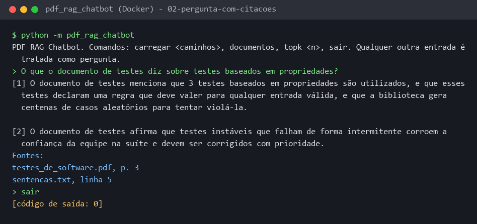
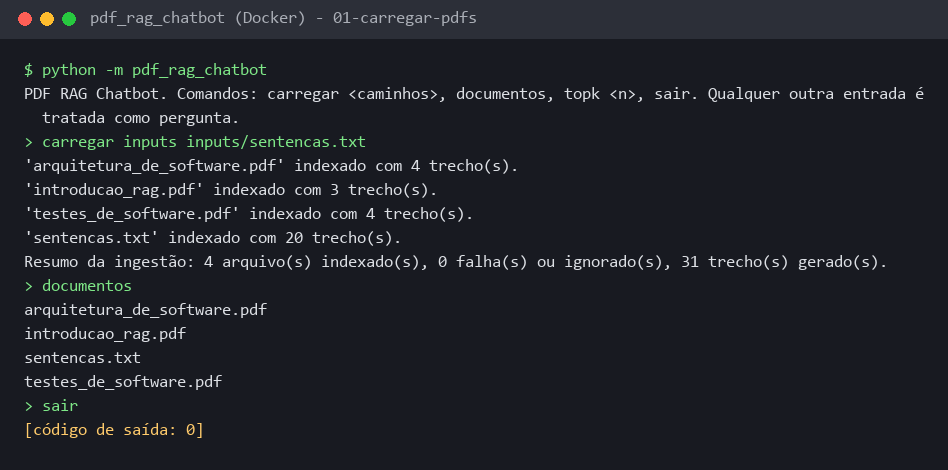
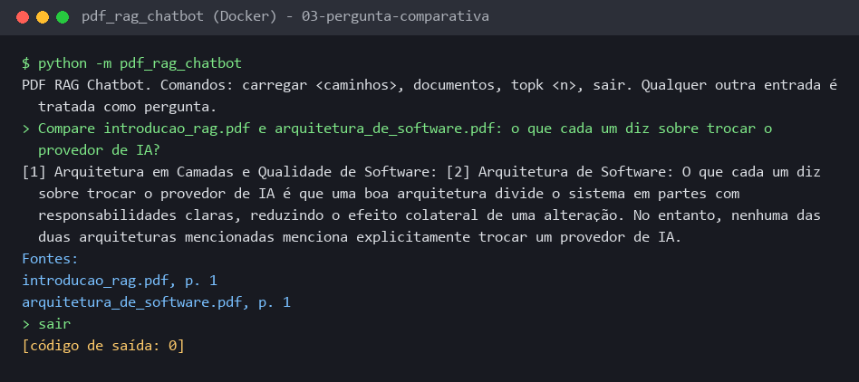
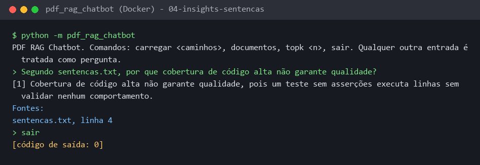
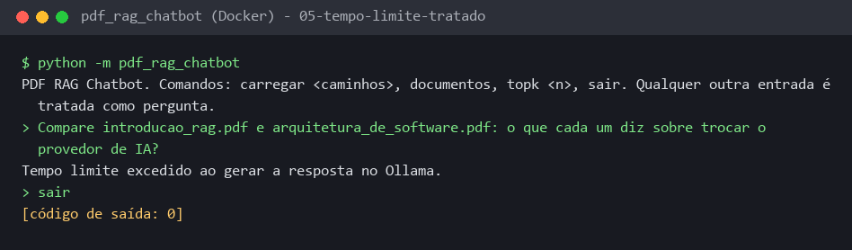
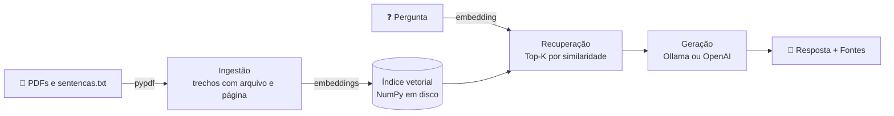

<div align="center">

# 📚 PDF RAG Chatbot

**Pergunte aos seus PDFs e receba respostas com citação de arquivo e página.**


[Descrição](#descrição-do-projeto) •
[Rodando com Docker](#rodando-com-docker-recomendado) •
[Prints](#prints-de-tela) •
[Como funciona](#processo-de-construção) •
[Insights](#insights-obtidos-com-a-análise-das-sentenças) •
[Uso responsável](#uso-responsável)



</div>

## Descrição do projeto

O PDF RAG Chatbot é um chatbot de linha de comando que responde perguntas com base no conteúdo de arquivos PDF fornecidos pelo usuário. Ele usa RAG (Retrieval-Augmented Generation): extrai o texto dos PDFs, divide o texto em trechos, gera embeddings, guarda tudo em um índice vetorial, recupera os trechos mais parecidos com cada pergunta e pede a um modelo de IA generativa que redija a resposta usando apenas esses trechos. Toda resposta vem acompanhada de citações com o nome do arquivo e a página de origem.

O cenário de uso é o de um estudante de Engenharia de Software que está escrevendo o TCC. Ele reuniu dezenas de artigos científicos e precisa revisar cada um, comparar abordagens e encontrar rapidamente onde um autor trata de determinado assunto. Em vez de reler tudo, ele carrega os PDFs, pergunta (por exemplo, "O que o artigo de testes diz sobre testes baseados em propriedades?") e recebe a resposta com a indicação exata de onde conferir a informação. Também pode fazer perguntas comparativas entre dois ou mais documentos e perguntas de acompanhamento, pois o chatbot mantém o histórico das últimas interações da sessão.

Os objetivos do projeto são: (1) oferecer uma ferramenta útil para revisão bibliográfica, (2) permitir escolher entre execução local gratuita, com Ollama, e uso de API externa, controlando custo e privacidade, e (3) servir como projeto de portfólio educacional, com código testado e documentação aberta (licença MIT). A interface e as mensagens são em português.

| ✨ Destaque | Como aparece no projeto |
| --- | --- |
| Respostas fundamentadas | Só usa os trechos recuperados e sempre lista as fontes |
| Perguntas comparativas | Busca trechos de cada arquivo citado na pergunta |
| Local ou nuvem | Ollama (gratuito, offline) ou OpenAI, por variável de ambiente |
| Índice persistente | Não precisa reindexar ao reiniciar |
| Seguro por padrão | A chave de API nunca aparece em saídas nem em logs |

> Este é um projeto pessoal e educacional.

## Instalação e execução

### Rodando com Docker (recomendado)

Só é preciso ter o [Docker](https://www.docker.com/) com Compose. O `docker-compose.yml` sobe o Ollama e o chatbot juntos, no modo local gratuito.

```bash
git clone https://github.com/Gtvnv/Chat-Bot.git
cd Chat-Bot

# 1. Sobe o Ollama e baixa os modelos (uma vez só, cerca de 2,3 GB)
docker compose up -d ollama
docker compose exec ollama ollama pull nomic-embed-text
docker compose exec ollama ollama pull llama3.2

# 2. Indexa os arquivos de exemplo e abre a sessão interativa
docker compose run --rm chatbot carregar inputs inputs/sentencas.txt
docker compose run --rm chatbot
```

> 💡 **Sem GPU?** Em CPU o `llama3.2` pode passar do limite de 60 s por resposta. Use o modelo menor: `docker compose exec ollama ollama pull llama3.2:1b` e rode com `MODELO_GERACAO_LOCAL=llama3.2:1b TOP_K=2 docker compose run --rm chatbot`. Os prints deste README foram feitos assim.

### Pré-requisitos (execução sem Docker)

- Python 3.11 ou superior e Git.
- Para o modo local: [Ollama](https://ollama.com) instalado e em execução.
- Para o modo com API externa: uma conta na OpenAI e uma chave de API.

### Passos (ordem de execução)

1. Clone o repositório e entre na pasta:

   ```bash
   git clone https://github.com/Gtvnv/Chat-Bot.git
   cd Chat-Bot
   ```

2. Crie e ative um ambiente virtual:

   ```bash
   python -m venv .venv
   # Windows (PowerShell)
   .venv\Scripts\Activate.ps1
   # Linux/macOS
   source .venv/bin/activate
   ```

3. Instale as dependências:

   ```bash
   pip install -r requirements.txt
   pip install -e .
   ```

4. Crie o arquivo de configuração a partir do modelo (o `.env` não é versionado):

   ```bash
   # Windows (PowerShell)
   Copy-Item .env.example .env
   # Linux/macOS
   cp .env.example .env
   ```

5. Configure o provedor conforme uma das subseções abaixo.

6. Inicie o chatbot:

   ```bash
   python -m pdf_rag_chatbot
   ```

   Para apenas indexar arquivos ou diretórios e sair: `python -m pdf_rag_chatbot carregar inputs`.

### Comandos da sessão interativa

| Comando | O que faz |
| --- | --- |
| `carregar <caminhos>` | Indexa arquivos `.pdf` (ou o `.txt` de sentenças) e diretórios. Aceita até 50 caminhos por vez. Recarregar um arquivo substitui os trechos anteriores dele. |
| `documentos` | Lista, em ordem alfabética, os arquivos indexados. |
| `topk <n>` | Define quantos trechos são recuperados por pergunta (de 1 a 20; padrão 4). |
| `sair` | Encerra a sessão e descarta o histórico. |

Qualquer outra entrada é tratada como pergunta (de 1 a 2.000 caracteres).

### Modo local gratuito (Ollama)

🔒 Nenhum conteúdo dos PDFs, trechos ou perguntas sai da sua máquina, e não há custo de API.

1. Baixe os modelos padrão:

   ```bash
   ollama pull nomic-embed-text
   ollama pull llama3.2
   ```

2. No `.env`, mantenha:

   ```env
   PROVEDOR_EMBEDDINGS=local
   PROVEDOR_GERACAO=local
   OLLAMA_HOST=http://localhost:11434
   MODELO_EMBEDDINGS_LOCAL=nomic-embed-text
   MODELO_GERACAO_LOCAL=llama3.2
   ```

3. Com o Ollama em execução, rode `python -m pdf_rag_chatbot`. Se o Ollama não responder em 10 segundos ou faltar um modelo, o chatbot informa qual componente falhou e como corrigir, sem recorrer a um provedor externo.

### Modo com API externa (OpenAI)

⚠️ Trechos dos documentos e perguntas são enviados a um serviço de terceiros. Defina as variáveis no `.env` ou no ambiente (o ambiente prevalece sobre o `.env`). Use a sua própria chave e nunca a escreva no código nem no `.env.example`.

| Variável | Descrição |
| --- | --- |
| `PROVEDOR_EMBEDDINGS` | `externo` para gerar embeddings pela API. |
| `PROVEDOR_GERACAO` | `externo` para gerar as respostas pela API. |
| `OPENAI_API_KEY` | Sua chave de API (valor secreto, não incluído neste repositório). |
| `MODELO_EMBEDDINGS_EXTERNO` | Modelo de embeddings (padrão `text-embedding-3-small`). |
| `MODELO_GERACAO_EXTERNO` | Modelo de geração (padrão `gpt-4o-mini`). |

Na inicialização, o chatbot avisa que trechos serão enviados a terceiros e nunca imprime o valor da chave. Os dois provedores podem ser combinados (um local e outro externo).

<details>
<summary><b>Parâmetros opcionais</b></summary>

| Variável | Faixa | Padrão |
| --- | --- | --- |
| `TAMANHO_TRECHO` | 100 a 10.000 caracteres | 1000 |
| `SOBREPOSICAO` | 0 a 50% do tamanho | 200 |
| `TOP_K` | 1 a 20 | 4 |
| `DIRETORIO_INDICE` | caminho | `data/index` |

</details>

### Rodando os testes

```bash
pip install -r requirements-dev.txt
pytest
```

A suíte tem testes de exemplo e testes baseados em propriedades (Hypothesis, 100 casos por propriedade) e não acessa a rede: os provedores são simulados.

## Prints de tela

Todos os prints são sessões reais da CLI rodando no contêiner do `docker-compose.yml`, com Ollama local (`nomic-embed-text` e `llama3.2:1b`, `TOP_K=2`, em CPU). As transcrições de texto estão em `docs/evidencias/` e as imagens foram geradas a partir delas por `scripts/renderizar_evidencias.py`. Para refazer: `docker compose run --rm -v "$PWD/docs:/app/docs" --entrypoint python chatbot scripts/capturar_evidencias.py`.

**1. Carregando os arquivos de exemplo e listando os documentos**



**2. Pergunta respondida com citações de arquivo e página**


**3. Pergunta comparativa entre dois documentos**



**4. Analisando o arquivo de sentenças**



**5. Tempo limite do modelo tratado sem derrubar a sessão**



## Processo de construção



### Ingestão

O Ingestor lê cada PDF página por página com a biblioteca `pypdf`, preservando a ordem das páginas. O texto é dividido em trechos de até 1.000 caracteres, com 200 de sobreposição, e cada trecho guarda o nome do arquivo e o número da página (a partir de 1). PDFs ilegíveis ou sem texto extraível são avisados e ignorados, e os demais arquivos continuam sendo processados.

### Indexação

Cada trecho recebe exatamente um embedding, sempre do mesmo modelo, gerado pelo Ollama ou pela API externa. O índice vetorial guarda vetor, texto, arquivo e página e é gravado em disco (`data/index` por padrão), então não é preciso reindexar ao reiniciar. Recarregar um PDF já indexado substitui os trechos antigos desse arquivo, e uma falha no meio do processo preserva o estado anterior.

### Recuperação

A pergunta é convertida em embedding com o mesmo modelo dos trechos e comparada ao índice por similaridade de cosseno (NumPy). O Recuperador devolve os `TOP_K` trechos mais similares, do mais para o menos parecido. Em perguntas comparativas, ele busca trechos de cada arquivo mencionado.

### Geração

O modelo recebe a pergunta, os trechos recuperados e as cinco interações mais recentes da sessão, e responde em português com até 2.000 caracteres. O chatbot exibe a resposta junto com a lista de citações sem repetições. Se não houver informação suficiente, ou se a resposta vier sem citações, ele avisa que não foi possível fundamentá-la nos documentos. Se o provedor falhar ou demorar mais de 60 segundos, a sessão continua e nada parcial é exibido.

<details>
<summary><b>Estrutura do código</b></summary>

```text
src/pdf_rag_chatbot/
├── cli.py             # comandos, inicialização e laço interativo
├── chatbot.py         # orquestra validação, recuperação, geração e citações
├── ingestor.py        # leitura de PDFs/TXT e chunking por página
├── chunking.py        # divisão em trechos com sobreposição
├── indice_vetorial.py # índice NumPy persistido com troca atômica
├── recuperador.py     # Top-K e perguntas comparativas
├── citacoes.py        # extração e formatação das fontes
├── embeddings/        # Ollama e OpenAI
├── geracao/           # prompt e provedores de geração
├── config.py          # leitura do .env e validações
└── log_seguro.py      # filtro que mascara segredos nos logs
```

</details>

## Insights obtidos com a análise das sentenças

O arquivo `inputs/sentencas.txt` reúne 20 sentenças sobre testes, arquitetura e boas práticas de engenharia de software. Ao analisá-las com a IA (veja o print 4), surgiram os pontos abaixo.

1. **Qualidade se sustenta em várias frentes ao mesmo tempo.** As sentenças ligam testes automatizados, integração contínua e revisão de código como práticas que se reforçam. Um chatbot sobre artigos pode ajudar a relacionar essas práticas entre documentos diferentes.
2. **Arquitetura desacoplada facilita trocar tecnologias.** Inversão de dependência e baixo acoplamento permitem trocar um provedor de IA ou banco de dados sem mexer na regra central. Esse princípio guiou a escolha de provedores intercambiáveis (local ou externo) neste projeto.
3. **Métricas isoladas enganam.** Uma das sentenças lembra que cobertura alta não garante qualidade. Da mesma forma, uma recuperação com alta similaridade não garante uma resposta correta, e por isso as citações são obrigatórias.
4. **Rastreabilidade e honestidade sobre limites são parte do produto.** As sentenças sobre citar fontes e documentar limitações apontam para respostas conferíveis e para o uso responsável descrito abaixo.
5. **Sentenças curtas funcionam bem como itens indexáveis.** Cada linha vira um item distinto com o nome do arquivo como fonte, o que torna a demonstração rápida e fácil de reproduzir.

## Limitações conhecidas

- PDFs digitalizados (apenas imagem) não têm texto extraível, e não há OCR.
- O índice vetorial é simples (arrays NumPy em disco, busca por força bruta), adequado para poucos milhares de trechos, e não para grandes coleções.
- Modelos locais pequenos erram mais. Nas sessões dos prints, o `llama3.2:1b` às vezes trouxe uma fonte pouco relevante, respondeu só com marcadores ou não fundamentou a resposta comparativa, e foi preciso repetir a pergunta.
- Em CPU, a geração local é lenta e pode estourar o limite fixo de 60 s (print 5).
- A divisão em trechos por tamanho fixo pode cortar frases, tabelas ou fórmulas e separar informação relacionada.
- A interface é apenas de linha de comando, o histórico existe só durante a sessão e a resposta é limitada a 2.000 caracteres.

## Possíveis evoluções

- Trocar o índice vetorial próprio por ChromaDB ou FAISS, ganhando busca aproximada e escala.
- Adicionar OCR para PDFs digitalizados.
- Dividir os trechos por estrutura (seções e parágrafos) em vez de tamanho fixo.
- Reordenar os resultados (re-ranking) e combinar busca vetorial com busca por palavras-chave.
- Tornar o tempo limite configurável e exibir a resposta em streaming.
- Criar uma interface web e suporte a outros provedores de IA.

## Uso responsável

- **Documentos sensíveis e provedores externos:** no modo com API externa, o conteúdo dos documentos indexados (trechos) e as suas perguntas são transmitidos ao provedor. Não envie documentos sensíveis ou confidenciais a provedores externos sem ciência dos riscos. Para esse tipo de material, use o modo local.
- **Guarda e revogação de chaves de API:** guarde a chave em variável de ambiente ou no arquivo `.env`, que fica fora do controle de versão (está no `.gitignore`). Nunca a coloque no código nem no `.env.example`. Se a chave for commitada ou exposta de alguma forma, revogue-a imediatamente no painel do provedor e substitua por uma nova.
- **Respostas de IA podem conter erros:** as respostas geradas por IA podem conter erros ou omissões e devem ser conferidas nos artigos originais, usando as citações de arquivo e página, antes de serem usadas no TCC.

## Arquivos de exemplo (`inputs/`)

Os PDFs foram gerados pelo script `scripts/gerar_pdfs_exemplo.py` (`python scripts/gerar_pdfs_exemplo.py`).

| Arquivo | Origem | Licença |
| --- | --- | --- |
| `inputs/sentencas.txt` | Autoria própria (Gustavo Vianna) | MIT |
| `inputs/introducao_rag.pdf` | Autoria própria, gerado por `scripts/gerar_pdfs_exemplo.py` | MIT |
| `inputs/arquitetura_de_software.pdf` | Autoria própria, gerado por `scripts/gerar_pdfs_exemplo.py` | MIT |
| `inputs/testes_de_software.pdf` | Autoria própria, gerado por `scripts/gerar_pdfs_exemplo.py` | MIT |

## Licença

Distribuído sob a licença MIT. Veja o arquivo [LICENSE](LICENSE).